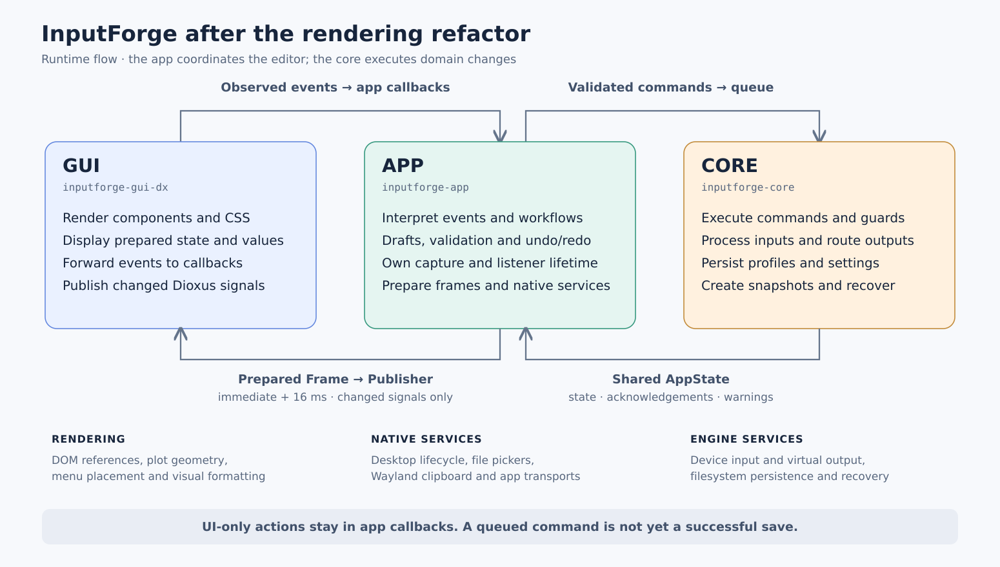
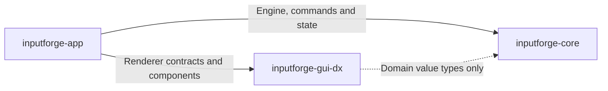

# InputForge architecture: core, app and GUI

The app coordinates the editor. The GUI renders prepared values and forwards observations to app-supplied callbacks. The core executes domain operations and runs the input/output engine.

## Runtime flow

- **GUI:** Dioxus components, CSS, labels, SVG/plot geometry, DOM references, menu placement and presentation signals. It allocates and publishes signals, but app callbacks decide workflow transitions. It has no production engine-state handle, command sender, filesystem, picker or clipboard access.
- **App:** Desktop hosting and service composition; event/shortcut interpretation; draft and confirmation policy; selection/navigation; undo/redo; capture/listener/drag lifetimes; notification/readout timing; and validation immediately before command delivery. It supplies `Bindings` to `render_editor` and owns native pickers and clipboard integration.
- **Core:** Domain data and rules; command execution and operation-specific stale-context guards; device input, action processing and output routing; profile/settings/snapshot persistence and recovery. The app constructs platform backends and starts the dedicated engine thread.
- **Updates:** The app's existing editor-scoped bridge samples shared `AppState` immediately and then every 16 ms using nonblocking `try_read`. It prepares a coherent `Frame`, releases the engine read guard before filesystem metadata work, then passes the result to the GUI `Publisher`. Equality checks publish only changed signal values. This GUI sampling cadence is separate from the engine's input/output loop.
- **Results and failure:** Sending a command means it entered the queue. It does not establish successful execution or persistence. Core state, acknowledgements and warnings return through the bridge; app controllers reconcile pending drafts/history. Validation/delivery failures keep the relevant draft or dialog and provide feedback. Existing guards and write/history barriers prevent obsolete work from targeting replacement content.
- **UI-only actions:** Opening a tab, editing an uncommitted draft or positioning a menu does not require a core command. The app can return prepared values directly through callbacks and publication handles.

## Compile dependencies

These arrows mean “depends on,” unlike the runtime arrows above.

The GUI still imports core **value types** for rendering contracts. It cannot access the running engine through its production renderer API. Core has no dependency on the app or GUI. Test fixtures have additional development-only dependencies and are excluded here.

## Example curve edit and undo

1. The GUI forwards the observed graph/input event to an app callback.
2. The app validates the current target, updates draft/history policy and queues the domain change when needed.
3. The core executes the change and updates shared state.
4. The bridge prepares the next frame and the GUI redraws changed signals.
5. Undo follows the same path: the app selects a history restoration and sends it to the core; the resulting state returns through the bridge.

## Source references

- [Desktop wiring](../crates/inputforge-app/src/desktop_host.rs#L75)
- [Renderer entry point](../crates/inputforge-gui-dx/src/lib.rs#L110)
- [App sampling and preparation](../crates/inputforge-app/src/bridge/mod.rs#L28)
- [GUI signal publication](../crates/inputforge-gui-dx/src/bridge.rs#L66)
- [App mapping history](../crates/inputforge-app/src/mapping_edits/mod.rs#L29)
- [Core command execution and errors](../crates/inputforge-core/src/engine/run.rs#L574)
- [Example execution-time guard](../crates/inputforge-core/src/engine/snapshots.rs#L25)
- [Final GUI ownership register](gui-rendering-boundary-ownership.md#L9)

Architecture snapshot checked against source on 2026-10-18. For the refactor verification record and native acceptance checklist, see the [GUI rendering boundary audit](gui-rendering-boundary-audit.md).
