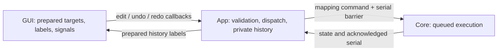
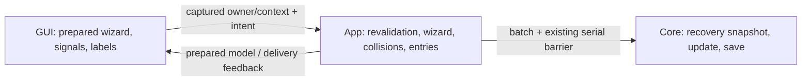

# GUI rendering boundary audit

Date: 2026-10-12. Latest implementation update: 2026-10-16.

## Scope and conclusion

The GUI still owns substantial application behavior. The tray extraction is
complete, but the rest does not meet the rendering-only boundary.

Requirements:

- `inputforge-gui-dx` owns rendering.
- Non-rendering logic and event handling belong in `inputforge-app`.
- Keep maximum code shared between Windows and Linux.
- Native Wayland is the primary Linux target.
- Do not introduce direct X11 APIs, commands, or workarounds in project code.
  Transitive dependencies may retain X11 support.

The original audit was read-only. The status below now also records the first
implemented routing, polling, controller-workflow, advanced-axis, live-capture,
keyboard-capture, shared mapping-dispatch/history, mapping-rail, batch-mapping and mode-management extractions;
the remaining findings are still open.

## Resolved routing controls — 2026-10-12

The first part of finding **#2** is resolved:

- [Shared app routing policy](../crates/inputforge-app/src/routing/policy.rs)
  prepares action availability and pending-layout review for the tray, engine
  pill, Devices routing buttons, and editor notice banner.
- [App routing dispatcher](../crates/inputforge-app/src/routing/mod.rs)
  rechecks current state before Start/Stop/Retry/Refresh, sends engine commands,
  and owns review navigation into Devices. It releases the engine lock before
  navigation and reports failed command delivery.
- [GUI routing contract](../crates/inputforge-gui-dx/src/routing.rs) supplies
  prepared rendering data and an app callback. These controls no longer build
  routing commands or mutate navigation. The former tray-only policy and GUI
  pending-layout gate have been removed.
- Offline engines have no available routing actions. Running/Starting sessions
  can still Stop when the active profile disappears. A stale Start/Retry click
  cannot bypass a newly pending retained-layout review.
- Core remains authoritative for session execution and output-layout comparison.
  Activate and Retry continue through the same existing session-start path.

The app-owned 16 ms bridge calls the routing projection using the same locked
state as its other snapshots, then publishes the result after releasing the lock.
Unchanged routing models do not trigger redundant signal updates. No second
polling loop was introduced, and the native tray dispatch cadence is unchanged.

**Controller selection, basic virtual-layout edits, and Apply in #2 are now
app-owned:** see the controller-workflow slice below. Advanced axis settings are
also app-owned in the later axis slice. Other configuration-editing/readiness gates
outside these controls remain open.
**#1 is partially resolved:** polling, snapshot preparation, and the basic
controller workflow now belong to the app. Other GUI workflow handlers still
receive engine handles and commands while their ownership remains to be extracted.
**#8 remains open:** only routing-related review navigation moved; other event
handling and UI state transitions remain.

Behavioral routing tests now live in
[the app](../crates/inputforge-app/src/routing/tests.rs). GUI tests cover prepared
disabled actions, accessible review labeling, callback delivery, and unchanged
model publication. The user reported the routing controls working in desktop
checks and subsequently reported a successful native Apply retest; see below.

## Engine polling first slice — 2026-10-12

The polling and snapshot-preparation part of finding **#1** is resolved:

- [The app bridge](../crates/inputforge-app/src/bridge/mod.rs) owns the single
  polling task and prepares configuration, live input/output, metadata, settings,
  and routing data from one engine read guard. The immediate first sample,
  16 ms interval, nonblocking `try_read()`, and skipped contended ticks remain.
- [GUI publication](../crates/inputforge-gui-dx/src/bridge.rs) owns the signals,
  non-subscribing selection reads, and equality-gated publication. The renderer
  supplies its publication handle to an app callback once per mounted scope;
  Dioxus scope teardown cancels the app task. No extra thread, polling loop,
  timer, or snapshot channel was introduced. Tray dispatch keeps its existing
  cadence and uses the same app routing policy.
- [Prepared rendering contracts](../crates/inputforge-gui-dx/src/snapshots/mod.rs)
  hold the snapshot values. All engine projection constructors, action-tree
  traversal, device-usage preparation, and timestamp preparation moved into
  small app modules. Redundant profile-row adapters were removed.
- [The app metadata cache](../crates/inputforge-app/src/bridge/profile_metadata.rs)
  reads modification times for synthesized active-profile rows only after the
  engine guard is released. It refreshes immediately on path changes and once
  per second otherwise, including after failed reads. Library rows keep their
  core-provided metadata. Labels are formatted from cached timestamps each tick;
  file changes may take up to one second to appear. Leaving synthesized rows
  clears the cache.
- The existing app package now has a small
  [library target](../crates/inputforge-app/src/lib.rs), allowing GUI fixtures and
  the seeded demo to reuse the production projection. Test-only dependencies
  and canonical renderer-value aliases avoid duplicate projection implementations;
  production GUI dependencies still do not include the app. The demo publishes
  a prepared fixture once and owns no polling loop.

**Still open in #1:** raw engine reads and command senders used by remaining GUI
workflow handlers. Capture revalidation moved in the live-capture slice below. The later controller slice
below resolves basic selection/layout/Apply ownership in #2; the later axis slice
resolves advanced axis settings. Other configuration gates and findings #3–10
remain open. Finding #7's
polling metadata read is resolved; dialogs, clipboard, and other services remain.

Behavioral projection and capture-epoch tests moved to
[the app bridge tests](../crates/inputforge-app/src/bridge/tests/mod.rs).
New metadata regressions cover refresh, path changes, failure recovery, cache
invalidation, and engine write-lock availability during metadata reads. The
[renderer integration regression](../crates/inputforge-gui-dx/tests/editor_bridge.rs)
uses paused time to verify the immediate sample, 16 ms cadence, contention skips
and recovery, one installation across rerenders, teardown, and remount.
[GUI publication tests](../crates/inputforge-gui-dx/src/bridge_tests.rs) verify
unchanged-frame suppression and non-subscribing selection reads.

## Polling-slice verification

- `cargo test --workspace --locked --offline`: 2,059 passed, 0 failed, 11 ignored.
  The first sandbox run could not create local IPC sockets in five existing
  single-instance tests (`Operation not permitted`); the host-enabled rerun passed.
- Strict production Clippy passed for both affected crates and examples:
  `cargo clippy --locked --offline -p inputforge-app -p inputforge-gui-dx --lib --bins --examples -- -D warnings`.
- Workspace/all-target Clippy remains blocked by the existing Rust 1.99
  `clippy::assert_is_empty` baseline. It passed with only that lint excluded:
  `cargo clippy --workspace --all-targets --locked --offline -- -D warnings -A clippy::assert_is_empty`.
  Repository lint settings were not relaxed. The contention fixture deliberately
  holds a write guard through a tick and records that with a narrow test-only
  `#[expect(clippy::await_holding_lock)]`.
- Formatting, `git diff --check`, and audit local-link checks passed.
- An independent read-only review found no actionable code issues.
- Changes remain uncommitted. The user reported the polling-slice manual desktop
  checks working, with one timestamp discrepancy: 20:30 appeared instead of 22:30.
  The existing formatter displayed UTC; it now displays the system's local time
  with its UTC offset, while stored timestamps and sort order remain UTC-based.
  The regression reproduced that exact discrepancy before the fix, and passed
  under `Europe/Paris`, `America/New_York`, and `UTC`, covering winter dates,
  midnight rollover, and dropped sub-second precision. The GUI fixture also
  checks that the prepared local timestamp reaches the tooltip.
  After the correction, all 945 app/GUI library tests and strict production
  Clippy passed; formatting and diff checks also passed.
  Native acceptance of this timestamp correction and performance measurements
  remain pending.

## Controller-workflow slice — 2026-10-12

The controller selection, basic virtual-layout editing, and Apply portions of
findings **#1** and **#2** are resolved:

- [App controller policy](../crates/inputforge-app/src/controllers/policy.rs)
  prepares selection rows, requested versus fixed-driver layouts, editing locks,
  retained-output presentation, pending Apply, and action availability.
  Input readiness alone does not lock editing; Running/Starting, retained input
  capture, offline state, and a missing profile do.
- [App controller edits](../crates/inputforge-app/src/controllers/edit.rs) own
  numeric parsing, selection mutations, slot allocation/removal, button/hat/axis
  edits, and command construction from the current profile. Disconnected selected
  controllers can be deselected; disconnected unselected or unknown identities
  cannot be newly selected. Removed slots and obsolete Apply operations dispatch
  nothing. Layout edits and selection do not reconnect outputs or start routing.
- [App callbacks and dispatcher](../crates/inputforge-app/src/controllers/mod.rs)
  recheck current state on each callback, release the engine read guard before
  command delivery, and return app-prepared error feedback for the panel alert
  as well as logging validation or delivery failures. A successful subsequent
  operation clears that feedback. They do not optimistically mutate engine state; core execution owns persistence, binding
  acquisition, hardware operations, and execution-time validation.
- [Core capability validation](../crates/inputforge-core/src/output/validation.rs)
  is the existing engine validator extracted for reuse by the app and engine.
  `ControllerConfig::validate()` still owns structural validation, and
  `SessionState::requires_output_reconfiguration()` still owns exact configurable
  versus compatible fixed-layout comparison. No parallel GUI validation rules
  were introduced.
- [GUI controller contract](../crates/inputforge-gui-dx/src/controllers.rs),
  [selection rendering](../crates/inputforge-gui-dx/src/frame/panel_slot/controller_session.rs),
  and [layout rendering](../crates/inputforge-gui-dx/src/frame/panel_slot/virtual_config.rs)
  retain prepared values, signals, markup, and callback wiring. These controller
  controls no longer read raw engine state, parse numeric fields, mutate controller
  configurations, or send engine commands. Repeated fields have slot-specific
  accessible names. Fixed layouts remain read-only while pending Apply stays
  separately available.

The existing app bridge prepares this model under the same engine guard as the
rest of the frame and publishes it after releasing the guard. GUI publication
uses the existing equality gate. The immediate sample, 16 ms cadence,
nonblocking contention skips, tray cadence, scope teardown, and remount behavior
remain unchanged. No extra poller, timer, thread, channel, dependency, or generic
workflow abstraction was introduced. The old GUI `update_config` helper was
removed, and the app shares one slot-range constant across projection and edits.

[App regressions](../crates/inputforge-app/tests/controllers.rs) cover state locks,
readiness, selection identity/disconnection, duplicate prevention, current-state
dispatch, slot reuse/full capacity, numeric and backend limits, axis toggles,
explicit Apply, fixed-driver presentation, and failed command delivery without
optimistic mutation. [Renderer event regressions](../crates/inputforge-gui-dx/src/frame/panel_slot/controller_events_tests.rs)
exercise the actual form/button handlers and verify app payloads, unparsed numeric
values, and no raw engine command delivery.
[Real-bindings feedback regressions](../crates/inputforge-gui-dx/tests/controller_feedback.rs)
verify visible alerts for rejected numeric edits, invalid Apply, and failed
command delivery, plus clearing on successful delivery and unchanged engine
configuration/retained outputs. This covers a review-discovered regression where
app prevalidation initially only logged errors that the engine previously made
visible. The missing-alert cases failed before the callback-feedback correction.
Existing controller rendering tests
now consume prepared values, including a regression where app availability
intentionally differs from the metadata snapshot. Publication tests cover
controller-only changes and unchanged-frame suppression. The renderer integration
fixture now opens Devices and verifies prepared native-slot updates on the existing
cadence, contention recovery, single installation, teardown, and remount.

**Still open after this controller slice:** keyboard capture, mappings/undo, device removal,
profiles/modes/settings, OS services, other configuration/readiness gates, and
other workflows in findings #1–10. Transitional raw handles remain for those
workflows. Advanced axis settings moved in the later axis slice below.
This controller slice has no new native acceptance evidence; the earlier
successful user-reported Apply timeout retest is retained below.

## Controller-slice verification

- Regression tests were written before controller implementation and observed
  failing for missing app behavior, ignored prepared availability/selection,
  and missing controller publication. The review-discovered missing alerts were
  separately reproduced through real app bindings before the feedback fix.
- `cargo test --workspace --locked --offline`: **2,072 passed, 0 failed,
  11 ignored**, including the existing explicit-Apply, invalid/running Apply,
  slow-destruction neutralization, and renderer polling/lifecycle regressions.
  The final run includes visible validation and failed-delivery feedback.
- Strict production Clippy passed:
  `cargo clippy --locked --offline -p inputforge-app -p inputforge-gui-dx -p inputforge-core --lib --bins --examples -- -D warnings`.
- Strict workspace/all-target Clippy remains blocked by the existing
  `clippy::assert_is_empty` baseline. The all-target check passed with only that
  lint excluded:
  `cargo clippy --workspace --all-targets --locked --offline -- -D warnings -A clippy::assert_is_empty`.
  New controller/test diagnostics were fixed; repository lint settings remain
  unchanged and unrelated baseline tests were not edited.
- Formatting, `git diff --check`, module-size checks, and audit local-link checks
  passed. The complete prior Apply timeout follow-up and native retest block was
  verified byte-for-byte against the pre-extraction audit.
- One independent read-only review found the visible-feedback regression above;
  it was corrected with failing-then-passing renderer regressions and the final
  green workspace run. It reported no other actionable issues.
- Changes are unstaged and uncommitted. Native Wayland/Windows acceptance of
  this controller slice and runtime performance measurements remain pending.

## Controller-slice manual acceptance

Use a disposable profile and run `dx run -p inputforge-app` on native Wayland;
repeat the applicable checks on Windows for separate platform acceptance.

1. In Devices while stopped, select/deselect connected controllers. Disconnect a
   selected controller and confirm it can be deselected; a disconnected unselected
   controller cannot be selected. Inspecting a device must not select it. Selection
   changes must preserve virtual layouts and mappings without reconnecting outputs.
2. On a configurable backend, add/remove slots and edit buttons, hats, and axes
   within the displayed driver limits. Confirm the first free slot is reused and
   other slots/selection are preserved. Invalid numeric/count values must not be
   persisted or applied and must show an explanatory alert; restore a valid value,
   confirm the alert clears, and reopen the profile to verify.
3. Start routing: selection and virtual-layout edits must lock. Stop: inputs remain
   visible and retained outputs remain connected and neutral. Change a layout:
   pending Apply appears and Start remains unavailable until review is completed.
4. With at least three virtual controllers, Apply changed layouts repeatedly.
   Confirm all outputs reconnect successfully, no slot-3 `packet write deadline`
   appears, pending review clears, and routing remains stopped until explicitly
   started. Unchanged layouts must not request another Apply.
5. On a fixed-driver backend, confirm native layouts and limits are displayed,
   editing/add/remove controls are unavailable, and extra compatible native slots
   do not create false pending review. A saved-profile layout change that requires
   reconfiguration must still allow Apply while capability fields stay read-only.
6. Switch panels/profiles, disconnect/reconnect inputs, and repeat Stop/edit/Apply/
   Start. Quit and relaunch: updates continue and no duplicate controller resources
   remain. This is manual lifecycle acceptance; automated fixtures do not prove
   native kernel timing, Windows behavior, compositor compatibility, or performance.

## Advanced-axis slice — 2026-10-12

The advanced axis settings portions of findings **#1** and **#2** are resolved:

- [App axis preparation and resolution](../crates/inputforge-app/src/controllers/axes.rs)
  select live session bindings first and saved profile bindings only for devices
  absent from the live table. Rows resolve persisted detection/override choices
  by native axis code, independently of logical display indices.
- The existing [controller contract](../crates/inputforge-gui-dx/src/controllers.rs)
  now carries axis rows and raw select-value/redetection intents. Each intent
  includes device identity, logical index, and native code. The existing app
  dispatcher rechecks the current table and refuses obsolete identities, removed
  slots, offline operations, or unavailable redetection before delivering commands.
- Global overrides remain available online regardless of Running/Starting,
  profile presence, input readiness, retained capture, or virtual-layout ownership.
  Redetection additionally requires a monitored device and a resolving axis.
  These rules intentionally differ from the basic controller-editing lock.
- App preparation and dispatch reuse `DeviceBinding::validate()`; redetection
  reuses `DeviceBinding::resolves()`. Malformed tables produce no rendered rows,
  and attempted operations against them return core validation feedback.
  The core axis engine and adapters retain sampling, detection heuristics,
  automatic/manual interpretation, persistence/rollback, and cached-value updates.
- [Axis rendering](../crates/inputforge-gui-dx/src/frame/panel_slot/axis_settings.rs)
  retains shared controls, display labels/formatting, and callback wiring. It
  no longer selects binding tables, resolves settings, decides availability,
  interprets field events, or sends engine commands. The sole-consumer raw
  `ConfigSnapshot.axis_settings` map and its per-tick copy were removed.
- Axis operations reuse the existing visible controller alert and app callback
  feedback, including failed command delivery and clearing on successful delivery.
  Dispatch releases the engine guard before delivery and never optimistically
  changes persisted settings. Backend persistence failures retain core warnings.

Axis rows travel in the existing coherent controller projection and equality-gated
publication. No extra poller, timer, thread, channel, dependency, host API, or generic
workflow framework was introduced. Immediate sampling, the 16 ms cadence,
nonblocking contention skips, tray cadence, scope teardown, and remount are intact.
The existing no-profile editor shell still hides Devices; app policy and isolated
axis rendering support no-profile data without changing that shell workflow.

[App regressions](../crates/inputforge-app/tests/axes.rs) cover sparse native codes,
live precedence/saved fallback, separate devices sharing native codes, logical
reordering, stale callbacks, missing devices/indices, automatic/manual choices,
readiness/monitoring/offline/resolution gates, core rejection of malformed tables,
failed delivery, and absence of optimistic settings mutation.
[Renderer regressions](../crates/inputforge-gui-dx/src/frame/panel_slot/controller_session_tests.rs)
retain prepared values and shared controls and make prepared availability disagree
with metadata. [Actual event regressions](../crates/inputforge-gui-dx/src/frame/panel_slot/controller_events_tests.rs)
verify native identity and raw field values reach app callbacks with no raw engine
dispatch. [Real-bindings feedback](../crates/inputforge-gui-dx/tests/controller_feedback.rs)
covers invalid values, failed delivery, clearing, and unchanged settings.
[Publication](../crates/inputforge-gui-dx/src/bridge_tests.rs) covers axis-only updates
and unchanged rows; [the polling fixture](../crates/inputforge-gui-dx/tests/editor_bridge.rs)
now verifies axis detection updates on the existing cadence, contention recovery,
single installation, teardown, and remount.

**Still open:** capture, mappings/undo, device removal, profiles/modes/settings,
OS services, other configuration/readiness gates, and other workflows in findings
#1–10. Transitional raw handles remain for those workflows. This extraction has
no new native acceptance evidence; the previous Apply timeout/native retest block
is preserved below without changes.

## Advanced-axis verification

- Regression tests preceded the extraction. The new app contract first failed
  to compile for missing axis rows/actions; after the minimal contract was added,
  five app cases failed for missing projection, dispatch, and validation behavior.
  GUI regressions separately failed for ignored prepared availability and missing
  prepared controls/events/feedback. These cases now pass through real app bindings.
- `cargo test --workspace --locked --offline`: **2,082 passed, 0 failed,
  11 ignored**. The sandbox run could not create local IPC sockets in the five
  existing single-instance tests; the host-enabled rerun passed. This includes
  core detection/override/Auto/redetection persistence, save rollback, cached
  polarity metadata updates, controller/Apply, and slow-destruction regressions.
- Strict production Clippy passed:
  `cargo clippy --locked --offline -p inputforge-app -p inputforge-gui-dx -p inputforge-core --lib --bins --examples -- -D warnings`.
- Strict workspace/all-target Clippy remains blocked by the existing
  `clippy::assert_is_empty` baseline. The diagnostic check passed with only that
  lint excluded:
  `cargo clippy --workspace --all-targets --locked --offline -- -D warnings -A clippy::assert_is_empty`.
  New test diagnostics were fixed, the larger polling fixture setup was separated
  from lifecycle assertions, and the controller resolver now routes global actions
  before profile edits. Repository lint settings and unrelated tests are unchanged.
- Formatting, `git diff --check`, touched-module size checks, and audit local-link
  checks passed. The complete Apply timeout follow-up/native retest block was
  verified byte-for-byte against the pre-extraction audit.
- One independent read-only review found no actionable extraction regressions.
  It confirmed the existing no-profile shell limitation described above.
- Changes remain unstaged and uncommitted. Native Wayland/Windows acceptance and
  runtime performance measurements for this axis slice remain pending.

## Advanced-axis manual acceptance

Run `dx run -p inputforge-app` with a disposable profile on native Wayland.
Repeat applicable steps on Windows for separate platform acceptance.

1. Open Devices → Advanced axis settings. Verify device aliases/names, axis labels,
   saved choices, and detected/not-detected text. With a sparse native-axis device,
   confirm changing one row affects that physical axis and no other device/axis.
2. Leave controls at rest, choose Auto, then Detect again. Verify the resting
   classification updates. Cycle Centered → Rests at minimum → Auto and confirm
   live bars update even without movement. Redetection must preserve an explicit
   override; Auto must restore the detected interpretation.
3. Start/Stop routing and repeat axis choices/redetection. Global axis controls
   remain usable while their engine is online even when layout/selection controls
   lock. An unmonitored or unavailable axis cannot redetect. A saved disconnected
   axis retains its override editor but cannot redetect; reconnect and verify.
4. Switch profiles, close/reopen Devices, and disconnect/reconnect the device.
   Verify settings remain global, identities stay correct, and updates continue.
   Quit/relaunch and confirm persisted choices/detection and continued updates.
5. Check existing Stop/edit-layout/Apply/Start behavior, including multiple virtual
   controllers, still works. Preserve the previous native Apply retest as separate
   historical evidence; this new extraction still requires its own acceptance.

## Live-capture slice — 2026-10-13

The live-input portion of finding **#3** and its engine access in **#1** are
resolved. Keyboard capture, Add/duplicate collision decisions, mapping mutations,
command construction and undo in **#4**, and other workflows are deferred.

- [App capture controller](../crates/inputforge-app/src/live_capture/mod.rs) owns
  exclusive capture and replacement, detector state, Escape interception, native
  binding confirmation, cancellation and one-time delivery. A consumer's stale
  cancel/drop cannot cancel another owner. Rearming the same owner keeps its
  workflow open and starts a fresh baseline. Listener cleanup dispatches directly
  during teardown and wakes the waiting receive task; unique listener keys and
  capture serials prevent old Escape events from cancelling a newer request.
- [GUI capture contract](../crates/inputforge-gui-dx/src/capture.rs) and
  [hook wiring](../crates/inputforge-gui-dx/src/patterns/live_capture/mod.rs) retain
  prepared targets, root/per-consumer listening signals, prompts, markup, and
  supplied callbacks. The four surfaces are Add, primary rebind, MergeAxis
  secondary input, and predicate input. Their existing completion handlers,
  explicit Add commit, no-op behavior, dispatch-before-undo and failure handling
  remain in the GUI pending their own extraction.
- [The existing app poller](../crates/inputforge-app/src/bridge/mod.rs) samples
  capture on every successful tick under its coherent engine read guard, then
  publishes and delivers after releasing the guard. Immediate sampling, the
  16 ms interval, nonblocking contention skips/recovery, root-scope cancellation,
  and tray cadence remain. Poller timestamps use Tokio's monotonic clock, matching
  its interval and allowing deterministic paused-time debounce tests. No second
  poller, timer, thread, dependency, or snapshot channel was introduced.
- The detector retains native cached addresses, first-tick baseline, the 0.15 axis
  deadband, 50 ms debounce, deterministic ties, and axis/button/hat filters.
  Unchanged held inputs still finish their debounce on polling ticks. Unready
  sessions wait and rebaseline; Running does not prohibit capture; offline
  sessions cancel. Generation and native-code layout changes rebaseline pending
  detection and reject candidates already awaiting delivery.
- [Current-state validation](../crates/inputforge-app/src/live_capture/policy.rs)
  checks stable profile identity, the live editing mode and selection, mapping
  existence, stored optional name and root actions, and rendered field identity.
  It repeats these checks plus readiness, epoch/native layout and captured-address
  presence immediately before delivery. Navigation changes are caught before
  consumer rerender. Engine guards are released before confirmation, callbacks
  or signal publication. Sparse native controls retain their original address.
- Mapping consumers retain same-address native confirmation before their no-op
  edit handlers. Failed confirmation cancels without completion. Add retains its
  existing explicit commit policy. Invalid MergeAxis paths are rejected from the
  prepared target before confirmation, preserving the previous rejection order.
  The new target-name lookup uses both mode and input and preserves `None`;
  display fallback names and another mode's name cannot invalidate capture.
  Existing mapping-save name policies are deferred with mapping edits.

[App detector regressions](../crates/inputforge-app/src/live_capture/tests/detection.rs)
move with the behavior. [Controller regressions](../crates/inputforge-app/tests/live_capture.rs)
cover ownership/rearm, delayed delivery, reentrant completion, profile/mode/name/
action/field invalidation, pre-rerender navigation, epoch/layout/readiness changes,
cache eviction, Running/offline rules and confirmation failure.
[Real renderer event regressions](../crates/inputforge-gui-dx/src/frame/mapping_editor/capture_events_tests/mod.rs)
click all four surfaces and preserve native addresses, existing commands/undo,
explicit Add commit, cancel controls, unnamed/cross-mode target names and invalid
stage rejection. The name and invalid-path cases failed before their corrections.
[Paused polling/lifecycle regressions](../crates/inputforge-gui-dx/tests/live_capture_polling.rs)
cover unchanged-input debounce, cadence, contention, exactly-once delivery,
stale/fresh Escape, root cleanup and remount with the real app bindings.

## Live-capture verification

- `cargo test --workspace --locked --offline`: 2,091 passed, 0 failed, 11 ignored.
  Five existing single-instance IPC tests could not create loopback sockets in
  the sandbox (`Operation not permitted`); the host-permission rerun passed.
- Focused checks passed: 68 app library tests, 10 app capture tests, 877 GUI
  library tests (including four real capture-event regressions), two capture
  polling/lifecycle tests, and the six existing bridge/controller-feedback tests.
- Strict production Clippy passed:
  `cargo clippy --locked --offline -p inputforge-app -p inputforge-gui-dx --lib --bins --examples -- -D warnings`.
  Strict workspace/all-target Clippy still encounters the existing Rust 1.99
  `clippy::assert_is_empty` baseline. The diagnostic check passed with only that
  lint excluded:
  `cargo clippy --workspace --all-targets --locked --offline -- -D warnings -A clippy::assert_is_empty`.
  New fixture warnings were corrected; repository lint configuration is unchanged.
- Formatting, `git diff --check`, new-module size checks, and local audit links
  passed. The full Apply timeout/native retest section below was checked
  byte-for-byte against the pre-extraction audit.
- Independent read-only review identified the unnamed/cross-mode target-name
  regressions and invalid-stage confirmation ordering; reproducing regressions
  passed after correction, and the follow-up review found no remaining issues.
- A Node self-check of the extracted production listener script verified
  capture-phase Escape, synchronous removal, shutdown acknowledgement and
  isolated listener keys. The Dioxus fake-document fixtures verify dispatched
  cleanup and receive-task release, not native WebView execution.
- Changes remain unstaged and uncommitted. Native Wayland/Windows hardware,
  WebView lifecycle acceptance and performance measurements remain pending.

## Live-capture manual acceptance

Run `dx run -p inputforge-app` with a disposable profile on native Wayland.
Repeat applicable checks on Windows for separate platform acceptance.

1. Add a mapping by pressing a button or moving an axis/hat. Confirm the prompt
   ends once, the source identifies the correct physical control, and the mapping
   is saved only by the existing explicit commit. Repeat with sparse native codes
   and multiple devices; no ordinal/device substitution may occur.
2. Rebind a named and an unnamed primary mapping, a MergeAxis secondary source,
   and a predicate source. Verify existing edit/undo behavior, axis-only filtering
   for MergeAxis, and that another mode using the same primary input does not
   cancel capture. Capture the same current source to verify its existing no-op
   behavior. For an ambiguous retained native control, verify deliberate rebind
   confirms only that control.
3. Arm one surface then another, rearm Add, press Escape, and use the Cancel
   buttons. Only the current owner may consume input; cancellation must produce
   no mapping edit/undo and must restore normal Escape behavior afterward.
4. While listening or during debounce, change editing mode/selection/profile,
   rename/edit/remove the target, disconnect/reconnect or refresh the input
   layout, and stop/start routing. No stale result may edit a different target.
   Unready capture waits for a fresh baseline; Running remains capturable.
5. Hold an input after its initial movement and verify completion still occurs.
   Close/reopen the editor and quit/relaunch while listening; verify no lingering
   Escape interception, double delivery or duplicate polling after remount.
6. Check the existing Stop/edit-layout/Apply/Start flow still works. The prior
   successful native Apply retest below remains historical evidence for that
   timeout fix; it is not acceptance of this capture extraction.

## Live-capture acceptance update — 2026-10-13

The user reported live capture working. This is user-reported native acceptance
of the live-input slice above, recorded separately from the previous successful
native Apply timeout retest below. It is not an independent hardware trace,
complete Windows/Wayland acceptance matrix, or performance measurement. It does
not establish native acceptance of the keyboard-capture extraction below.

## Keyboard-capture slice — 2026-10-13

Keyboard capture and translation in finding **#3** are now app-owned. Mapping
mutations, command construction, undo, and other editor workflows in **#4** remain
deferred.

- [App controller](../crates/inputforge-app/src/keyboard_capture/mod.rs) owns
  editor-scoped exclusive capture, replacement/rearm, cancellation and hint
  ownership. Stale consumer cancel/drop cannot cancel another owner. A request
  serial rejects events queued before replacement; pending commits ignore repeat
  events. One passive root listener is installed before editor shortcuts and
  reused across arms and rerenders.
- [Physical translation](../crates/inputforge-app/src/keyboard_capture/translation.rs)
  and [capture machine](../crates/inputforge-app/src/keyboard_capture/machine.rs)
  retain physical `code` identity rather than layout-dependent characters, numpad
  distinctions, left/right modifiers, unidentified Meta/Super location, AltGr's
  synthetic Ctrl suppression, fallback flags, modifier-only release, multi-modifier
  rejection and the swallowed-base-keydown fallback. Unsupported keys and Escape
  cancel without committing.
- [App listener](../crates/inputforge-app/src/keyboard_capture/listener.rs) and
  [production script](../crates/inputforge-app/assets/keyboard_capture_listener.js)
  own capture-phase interception, arming/disarming, synchronous root cleanup and
  receive-task release. While armed, default/propagation prevention includes
  immediate propagation so later same-window editor shortcut listeners cannot
  interpret captured keys. Unique listener keys isolate root replacement; an old
  shutdown cannot dispose the new listener. Idle listeners do not intercept keys.
- [Target policy](../crates/inputforge-app/src/keyboard_capture/policy.rs) checks
  stable profile identity, editing mode and selection, the mapping's stored
  optional name and root actions, and the exact typed edit/insertion path. The
  app validates on start, reactive target/navigation changes and immediately
  before delivery. Removed mappings, invalid branches, shifted stages and stale
  targets receive no completion. Another mode's name and display fallback names
  cannot invalidate capture. Keyboard capture adds no controller readiness,
  native-layout, Running, or hardware-confirmation gate.
- [App delivery](../crates/inputforge-app/src/keyboard_capture/delivery.rs) keeps
  the surface logically active through pending completion and until its existing
  commit handler returns. It releases engine and controller guards before the
  callback; completion may rearm the same or another owner. Cancel/replacement
  discards pending completion, and signal publication tolerates disposed consumers.
- [GUI contract](../crates/inputforge-gui-dx/src/keyboard_capture.rs) and
  [hook wiring](../crates/inputforge-gui-dx/src/patterns/keyboard_capture/mod.rs)
  retain prepared targets, display/pending signals, navigation subscriptions and
  supplied callbacks. The hooks forward target/navigation changes to app
  validation rather than owning cancellation policy. The existing
  [Add stage](../crates/inputforge-gui-dx/src/frame/mapping_editor/pipeline/add_palette.rs)
  and [keyboard field](../crates/inputforge-gui-dx/src/frame/mapping_editor/pipeline/stage_body/map_to_keyboard.rs)
  retain action construction, dispatch and undo handlers. The keyboard field still
  publishes its local combo only after successful dispatch, ignores unchanged stale
  props, and accepts later external edits/undo. Existing mapping-save name lookup
  policy remains deferred with mapping edits.

The shared global owner counter, delivery sequence/wrapper, GUI state machine,
GUI browser translation and listener flags were removed. Add's separate armed
profile-name/path snapshot and comparison helper were replaced by the app's
stable target validation. These simplifications are covered by owner/rearm,
pending display, target invalidation and real-handler regressions. No new poller,
timer, thread, generic workflow framework or third-party dependency was added;
Serde and test JSON reuse existing workspace dependencies. The existing poller's
immediate sample, 16 ms cadence, contention behavior and teardown are unchanged.

[Moved behavioral tests](../crates/inputforge-app/src/keyboard_capture/tests.rs)
cover translation and modifiers. [App controller regressions](../crates/inputforge-app/tests/keyboard_capture.rs)
cover ownership, repeats, pending delivery/cancel, current-state rejection,
pre-rerender navigation, invalid destinations, reentrancy, exclusive hints and
root lifecycle. [Renderer frame regressions](../crates/inputforge-gui-dx/src/patterns/keyboard_capture/display_tests.rs)
cover pending-display ordering and cancellation on target/navigation changes
before any further key. [Actual control regressions](../crates/inputforge-gui-dx/src/frame/mapping_editor/pipeline/keyboard_events_tests.rs)
click both surfaces through real app bindings, verifying existing commands,
name preservation, dispatch-before-undo, no optimistic engine mutation, stale
props and failed-dispatch display. The previous unit coverage for later prop
changes/undo and failed dispatch remains in the keyboard field.

## Keyboard-capture verification

- Final host-enabled `cargo test --workspace --locked --offline -j 2`:
  **2,099 passed, 0 failed, 11 ignored**. The first sandbox run failed in the five
  existing single-instance IPC fixtures because loopback socket creation is denied
  there; the host rerun passed. Two build jobs bounded linker memory during the
  final run. No ignored native/hardware fixture was enabled.
- This includes **88 app library tests, 12 keyboard-controller tests and 853 GUI
  library tests**, plus existing controller/Apply, live-capture, feedback and
  paused polling/lifecycle coverage. Renderer tests exercise both actual keyboard
  surfaces, successful/failed dispatch and capture display frames.
- Strict production Clippy passed for both affected crates and examples:
  `cargo clippy --locked --offline -p inputforge-app -p inputforge-gui-dx --lib --bins --examples -- -D warnings`.
  Strict workspace/all-target Clippy still fails exclusively on the existing
  Rust 1.99 `clippy::assert_is_empty` baseline. Its diagnostic run passed with only
  that lint excluded:
  `cargo clippy --workspace --all-targets --locked --offline -- -D warnings -A clippy::assert_is_empty`.
  New fixture/style diagnostics were corrected; repository lint settings and
  unrelated baseline tests were not changed.
- Formatting, `git diff --check`, local audit links and app-module size checks
  passed. The complete Apply timeout/native-retest block was checked byte-for-byte
  against the pre-extraction audit. `use_combo_sync`, `commit_capture_combo`,
  `dispatch_keyboard` and Add's existing insertion/undo handler were unchanged at
  extraction completion. The label follow-up below fills the keyboard handler's
  presentation values without moving mapping/undo ownership.
- The executable production listener self-check passed:
  `node crates/inputforge-app/tests/keyboard_capture/listener.mjs crates/inputforge-app/assets/keyboard_capture_listener.js`.
  It verifies passive idle behavior, physical payloads, capture-phase/default/
  same-window shortcut interception, arming/disarming, isolated synchronous cleanup
  and shutdown acknowledgement. Fake Dioxus document tests verify dispatched
  lifecycle operations and receive-task release; they do not execute a native WebView.
- Independent read-only review found target-invalidation and exclusive-hint parity
  gaps. Both were reproduced before correction, and the follow-up found no
  remaining actionable issues.
- Changes were left unstaged and uncommitted at extraction completion. Subsequent
  user-reported app acceptance is recorded below; platform-specific checklist
  coverage and performance measurements remain unverified.

The controller tests first failed for the missing app contract and listening
behavior. The executable listener check reproduced missing synchronous cleanup; the
root-reuse, reinstall, target-invalidation and exclusive-hint cases
were separately reproduced before their corrections; independent review found
the latter two parity gaps and its follow-up found no remaining actionable issues.
The old source-text listener assertion and sequence-counter assertion were
replaced by executable listener and end-to-end delivery/lifecycle checks.

## Keyboard-capture manual acceptance

Run `dx run -p inputforge-app` with a disposable profile on native Wayland.
Repeat applicable checks on Windows for separate platform acceptance.

1. Capture a keyboard stage through Add, then recapture an existing keyboard
   field. Try a different physical layout (including AZERTY), main/numpad keys,
   right/left modifiers, AltGr and a modifier-only release. Verify physical
   identity, the displayed combo and saved output behavior; multi-modifier-only
   or unsupported input must cancel with the existing hint.
2. Hold/repeat a key or modifier and try Ctrl+S, Ctrl+Z, Alt+arrow and another
   available WebView shortcut while armed. Capture must finish once with one
   mapping edit/undo, and no unrelated shortcut action. After completion/cancel,
   normal shortcuts must work again. OS-reserved keys may never reach the WebView.
3. Arm one surface, another surface and the same surface again. Try Escape and
   the Add prompt's cancel control. Only the current owner may receive input;
   cancellation must produce no edit/undo. An unsupported-key hint from the first
   owner must disappear when another owner starts.
4. While listening, switch editing mode/selection/profile, change keyboard output
   behavior, or edit/remove/reorder the destination. Capture must disarm when the
   prepared target/navigation changes; no delayed result may edit another target.
   Verify a different mode using the same source does not invalidate a valid target.
5. Recapture F11 as F12 and watch the transition: the old key must not briefly
   return. Undo/redo must synchronize afterward. Verify rejected/failed delivery
   retains the saved key and produces no phantom undo. Close/reopen and quit/relaunch
   while armed; no lingering interception or duplicate listener may remain.
6. Repeat live input capture and Stop/edit-layout/Apply/Start. The earlier native
   Apply retest and separately reported live-capture success remain historical
   evidence for those slices; this extraction needs its own native acceptance.

## Keyboard undo-label follow-up — 2026-10-14

The user reported `Map to keyboard: key ? -> ?`. The existing GUI keyboard
handler supplied the stage and field names to the undo formatter but omitted
`before_after`, so the formatter used its `?` fallback. The extraction had kept
that handler unchanged; this is a separate presentation fix.

[The shared keyboard dispatcher](../crates/inputforge-gui-dx/src/frame/mapping_editor/pipeline/stage_body/map_to_keyboard.rs)
now resolves the saved keyboard action at the exact stage path and supplies old
and new values. Key changes reuse the field's combo formatter, including modifier
labels; behavior changes display Hold/Pulse values. Command construction and
successful-dispatch-before-undo ordering remain unchanged. Existing history
labels are not rewritten; subsequent edits create the corrected labels. Mapping
and undo workflow extraction remains deferred.

[Actual-control regressions](../crates/inputforge-gui-dx/src/frame/mapping_editor/pipeline/keyboard_events_tests.rs)
first reproduced `key ? -> ?` and `behavior ? -> ?`, then passed with
`Map to keyboard: key F11 -> F12` and
`Map to keyboard: behavior Hold -> Pulse`. The control selector was narrowed to
text within the exact button so Pulse tests cannot accidentally click a sibling.
Existing failed-dispatch, stale-props and undo-order coverage remains in place.

- `cargo test --workspace --locked --offline -j 2` with host IPC permissions:
  **2,100 passed, 0 failed, 11 ignored**. The 22 focused keyboard-related GUI tests
  include the reproducing label cases and both successful/failed delivery paths.
- Strict app/GUI production Clippy and examples passed. GUI all-target Clippy
  passed with only the existing `clippy::assert_is_empty` baseline excluded;
  repository lint configuration remains unchanged.
- Formatting, `git diff --check`, local audit links and byte-for-byte preservation
  of the previous Apply timeout/native-retest block passed.
- Changes were left unstaged and uncommitted at follow-up completion; subsequent
  user-reported app acceptance is recorded below.
For native acceptance, capture a new key combination and change Hold/Pulse;
check the new undo hints and confirm undo/redo still restores the expected mapping.
Earlier Apply and live-capture acceptance evidence remains separate and unchanged.

## User-reported app acceptance — 2026-10-14

After the keyboard-capture extraction and undo-label follow-up, the user reported:
“i tested the app. It works”. This records successful user-reported app acceptance
of the current changes. The report does not specify individual checklist cases,
platforms or explicit undo-label observations; those details and performance
measurements remain unverified. This is separate from the earlier native Apply
retest and live-capture success, whose evidence remains unchanged.

## Pre-commit Clippy follow-up — 2026-10-14

The user reported commit-time Clippy failures. The unchanged pre-commit command,
`cargo clippy --all-targets -- -D warnings`, reproduced 136
`clippy::assert_is_empty` diagnostics with Rust 1.99. Earlier all-target checks
excluded that baseline lint and therefore did not establish a passing commit gate.

The 136 flagged test assertions across 49 Rust files now compare collection/string
lengths with zero using `assert_eq!` or `assert_ne!`. The expected empty/nonempty
conditions remain the same, with actual lengths shown on failure. Only those
assertions and their formatting changed; production behavior, the hook and lint
configuration remain unchanged.

- `bash .githooks/pre-commit` passed formatting and strict all-target Clippy with
  no lint exclusions.
- `cargo test --workspace --locked --offline -j 2` with host IPC permissions:
  **2,100 passed, 0 failed, 11 ignored**.
- The previous native Apply evidence and separate user-reported acceptance remain
  unchanged. These follow-up changes are uncommitted; the user's staged hook
  permission changes were preserved.

## Shared mapping dispatch and history slice — 2026-10-14

This approved extraction partially resolves findings **#1**, **#4** and **#8**.
The dated capture sections above record ownership at their implementation time;
this section supersedes their deferral of shared mapping dispatch and undo. Batch
mapping, profile/mode/snapshot workflows and curve/deadzone algorithms remain open.

- [The app controller](../crates/inputforge-app/src/mapping_edits/mod.rs) owns
  editor-scoped history and lifecycle, current profile/mode/selection validation,
  dispatch, undo/redo, invalidation and the inclusive 250 ms nudge window. Grouping
  includes mapping, stage, arrow direction and focused handle; timeout, focus or
  navigation changes, intervening edits and restores end a group.
- [Preparation](../crates/inputforge-app/src/mapping_edits/prepare.rs) preserves
  exact optional names, uses core's existing action-tree validator, and rejects
  stale or malformed targets before delivery. Edits and restores reconcile private
  history under their validation read guard, so a polling contention skip cannot
  allow stale history to resurrect an external deletion. [Path edits](../crates/inputforge-app/src/mapping_edits/paths.rs)
  handle root-relative Conditional, Tap and Press branches. Queued edits use the
  latest delivered tree; known older renderer snapshots can support disjoint
  field edits across engine acknowledgements, but structural/restore boundaries
  block stale positional edits and parent replacement cannot erase newer children.
- [History](../crates/inputforge-app/src/mapping_edits/history/mod.rs) keeps restore
  snapshots private, with the existing 50-entry FIFO limit per mapping. Fresh
  edits clear redo. Undo restores the before snapshot and redo the delivered final
  snapshot, including a grouped burst. Empty mappings remain present with their
  optional names. Rebind preserves its existing forward SetMapping behavior;
  undo restores or removes the destination according to its original existence.
  Destination edits invalidate dependent history, and source deletion cannot
  restore stale rebind history. Stable profile identity, mappings and modes
  isolate histories; external replacements/deletions invalidate affected stacks.
- [Dispatch](../crates/inputforge-app/src/mapping_edits/dispatch.rs) releases
  engine/controller guards before command delivery and signal publication. History
  changes only after successful edit/restore delivery. A small
  [core queue barrier](../crates/inputforge-core/src/engine/command.rs) records an
  owner/serial marker in AppState after preceding commands. This distinguishes
  unfinished A→B→A command chains from confirmed round trips and external changes,
  including intermediate engine snapshots; equality alone cannot acknowledge them.
  It introduces no routing decision, dependency, thread or polling task.
- [The GUI contract](../crates/inputforge-gui-dx/src/mapping_edits.rs) contains
  prepared paths/intents, display labels, read-only history summaries, signals and
  callbacks. The old GUI mutable history and nudge timer were removed. Field
  action construction, labels, SVG/geometry, local capture display and callback
  wiring remain in the GUI. Keyboard capture still publishes the local combo
  only after successful dispatch, resists unchanged stale props and accepts
  external edits/undo. Gesture threshold/toggle local drafts remain intact.
- The existing 16 ms app bridge calls history reconciliation after publication;
  reconciliation skips contended state reads. GUI navigation changes forward the
  same callback. Teardown disposes history; remount starts empty while owner/serial
  identity prevents old queue acknowledgements from confirming new commands.
  Engine handles at the renderer entry now use the existing RawHandles bundle;
  they remain transitional for deferred workflows.

All history callers were included:

| Callers | Result |
| --- | --- |
| Stage fields: ChangeMode, keyboard/mouse/vJoy, MergeAxis, predicate, Tap/Press | Shared app replacement dispatch; labels and typed capture targets remain GUI-prepared. |
| Add palette, stage menu remove/move, pipeline drop | App insert/remove/move dispatch; GUI expansion/hint invalidation and gap/drag wiring retained. |
| Curve/deadzone toolbars, pointer-release commits and keyboard nudges | Shared dispatch/history; one drag commit, nudge group metadata and focus callbacks retained. Algorithms deferred. |
| Editor header rename and primary rebind | App dispatch and complete destination restoration. |
| Editor keyboard undo/redo and history recap | App restore callbacks and prepared label summaries. |
| Rail inline rename | App obtains current actions and validates captured optional-name metadata even after config advances; no GUI engine-state read. |
| Rail add/duplicate/replace, duplicate to another mode and delete | Existing deferred forward workflow retained; successful delivery invokes app forget for the affected mapping, while failed delivery leaves history intact. |
| External profile/mode/mapping changes | App reconciliation detects stable profile identity changes and missing/replaced mappings, invalidating related history rather than resurrecting stale state. |
| Root unmount/remount and existing bridge publication | App disposal/reconciliation with GUI signal ownership; no new poller. |

Regression coverage was written before the extraction implementation. Additional
review regressions reproduced stale structural targets, core-rejected trees,
round-trip acknowledgement ambiguity, overlapping nested edits, write-contention
revalidation, delivery-before-
render timing and rebind invalidation before their controller fixes. Tree mutation
coverage moved to app-backed tests; real GUI keyboard/capture handlers, labels,
DnD callback delivery, stale rail metadata and root lifecycle are also covered.

## Mapping-slice verification

- `bash .githooks/pre-commit` passed unchanged: formatting and
  `cargo clippy --all-targets -- -D warnings`, with no lint exclusions.
- `cargo test --workspace --locked --offline -j 2` with host IPC permissions:
  **2,107 passed, 0 failed, 11 ignored**. The initial sandbox run could not create
  sockets for five existing single-instance tests; the host-enabled suite passed.
- The suite includes **43 app mapping regressions**, **817 GUI library tests**,
  app-backed renderer integration/polling/lifecycle tests and the core command-
  barrier regression. The added contention test covers both dispatch and undo.
- `git diff --check`, audit local-link checks and unchanged acceptance-section
  checks passed. All new app modules remain below 200 nonblank code lines.
  Independent read-only review found no further issues after regression fixes.
- The hook, lint configuration and dependencies remain unchanged. All changes
  remain uncommitted and unstaged.

The user subsequently reported this slice seems to work fine; see the acceptance
update below. Individual native checklist cases, platforms and performance remain
unverified. Earlier native Apply, live-capture and user-reported app acceptance
sections remain unchanged. No commit or staging is part of this work.

## Mapping-slice manual acceptance

Run `dx run -p inputforge-app` on native Wayland; repeat on Windows when available.

1. Edit named and unnamed mappings, including the same input in two modes. Change
   keyboard/mouse/vJoy targets, ChangeMode, MergeAxis and predicates. Confirm names,
   undo labels and input identities; switching mode/profile must isolate histories.
2. Capture a keyboard combo in the field and Add palette. It must update immediately,
   remain visible through unchanged stale props, and dispatch once. Check unsupported
   keys/Escape, modifier-only combos, typing in text fields, and Ctrl+Z/Y interception
   while listening. Undo/redo and external changes must restore the displayed combo.
3. Add, remove and reorder stages in every Conditional/Tap/Press branch, including
   cross-branch drops. Confirm expansion survives in unaffected branches, invalid or
   source-adjacent drops do nothing, and deleting the last stage keeps its named row.
   Quickly edit sibling stages and gesture threshold then toggle; no queued edit
   may disappear. Undo/redo repeatedly and confirm each complete before/after tree.
4. For both curve and deadzone plots, drag and release once, then undo/redo once.
   A same-arrow/same-handle burst within 250 ms must undo to its initial value and
   redo to its final value. Wait longer, change arrow/handle/stage, Tab/Home/End,
   focus elsewhere, navigate away/back or perform another edit; each must split
   the group. Existing plot geometry and calculations should behave identically.
5. Rename in the editor and rail, rebind a primary input to unused and existing
   targets, then undo/redo. Destination mappings must restore correctly. Use rail
   add/duplicate/replace, duplicate-to-mode and delete after making editor history;
   old history must not overwrite replacement work or resurrect a deleted source.
   Change/delete targets during capture and verify stale completion is rejected.
6. Close/reopen the editor and quit/relaunch. History must be fresh, listeners and
   polling must install once, and no stale undo/redo may affect a new session.
   Recheck Stop/edit-layout/Apply/Start; the previous successful native Apply retest
   is historical evidence for its timeout fix, independent of this slice.

## Mapping-slice acceptance update — 2026-10-14

After the shared mapping dispatch/history extraction, the user reported:
“seem to work fine”. This records user-reported acceptance of this slice. The
report does not specify individual manual checklist cases, platforms or timing
measurements; those remain unverified. This evidence is separate from the prior
native Apply retest, live-capture success and earlier user-reported app acceptance,
whose recorded evidence remains unchanged.

## Mapping-rail workflow slice — 2026-10-14

This approved bounded extraction partially resolves findings **#1**, **#3**, **#4**
and **#8**. It supersedes the earlier sections' deferral of rail Add/duplicate,
collision decisions, duplicate-to-mode, delete and row reorder. Batch mapping,
profile/mode workflows and curve/deadzone algorithms remain deferred.

- [The existing app mapping controller](../crates/inputforge-app/src/mapping_edits/mod.rs)
  supplies rail callbacks and retains editor-scoped history, navigation publication,
  reconciliation and disposal. No separate controller, poller, timer or dependency
  was introduced. Disposed rail callbacks reject saved targets; reinstall starts
  fresh while the existing queue owner/serial identity remains intact.
- [Target/menu preparation](../crates/inputforge-app/src/mapping_edits/rail/mod.rs)
  checks stable profile identity, editing mode, offline state, source existence and
  captured metadata. It prepares full mapping targets, other modes and reorder
  availability from current app state. Known queued edits supply current actions;
  missing or externally replaced sources cannot silently become empty duplicates.
- [Add preparation](../crates/inputforge-app/src/mapping_edits/rail/add.rs) owns
  opening, capture completion, refresh, cancellation, collision reconciliation,
  explicit commit and collision navigation. Blank names remain `None`; nonblank
  names are trimmed. Add capture still requires an explicit button/Enter commit.
  Both collision surfaces open the existing destination rather than overwriting it.
  Commit rechecks collisions, so a newly occupied destination cannot be silently
  replaced. Removed duplicate sources close the pad and release capture.
- [Dispatch](../crates/inputforge-app/src/mapping_edits/rail/dispatch.rs) releases
  engine/controller guards before delivery and publication. Successful mapping
  delivery plus the existing queue barrier precede affected-history invalidation,
  selection changes and closing the pad/dialog/menu. Failed delivery retains the
  draft or confirmation surface and publishes visible error feedback. Action-tree
  validation remains core-owned and is reused before dispatch.
- [Forward history invalidation](../crates/inputforge-app/src/mapping_edits/history/rail.rs)
  clears affected/dependent restore stacks while preserving the already delivered
  command chain. This retains acknowledgement of delete→re-add round trips.
  Unrelated mappings and modes keep their history. Delete still uses forward
  removal and history invalidation; it does not introduce a new delete-undo stack.
  The confirmation text no longer incorrectly promises undo for that operation.
- [Reorder preparation](../crates/inputforge-app/src/mapping_edits/rail/reorder.rs)
  validates source identity, mode, group, captured order and filtering. It handles
  Up/Down and pre-removal gaps; boundaries and source-adjacent gaps are no-ops.
  Outstanding reorders and queued membership changes gate further moves until
  the existing owner/serial barrier acknowledges them, preventing old positions
  from being reused. Reorder preserves edit history and ends an active nudge group.
- [The GUI contract](../crates/inputforge-gui-dx/src/mapping_rail.rs),
  [Add pad](../crates/inputforge-gui-dx/src/frame/mapping_list/add_inline.rs),
  [rail handlers](../crates/inputforge-gui-dx/src/frame/mapping_list/mod.rs) and
  [row wiring](../crates/inputforge-gui-dx/src/frame/mapping_list/row.rs) retain
  prepared data, signals, labels, markup and supplied callbacks. The rail no
  longer reads raw engine state or constructs/sends mapping commands. Drag start
  captures the app-prepared source and group order; a later rerender cannot
  substitute another row at the same index. Accessibility success announcements
  are formatted only from successful app reorder results.
- Existing rail keyboard and idle-Escape transports remain renderer wiring.
  They now remove listeners synchronously and send shutdown on scope teardown;
  controller/scope keys isolate mounts. The capture primitives, native target
  confirmation, keyboard pending display, stage dispatch, nudge grouping and
  core persistence/execution behavior remain unchanged. The existing bridge still
  samples immediately and every 16 ms, skips contended reads and owns one task.

All affected callers are included:

| Callers | Result |
| --- | --- |
| Add dashed row, forced open, pending Duplicate hook/effect; three rail mount branches | App prepares opening/duplicate state; GUI retains copy-name display and capture wiring. |
| Capture completion, Refresh, Cancel, idle Escape and collision-drift effect | App transitions/revalidation; existing capture owner cancellation is retained. |
| Add button and Enter; collision Edit existing | Shared app commit/navigation callbacks; failed dispatch retains the draft. |
| Context menu Duplicate to mode | Current source actions and destination collision decision in app; source mode history retained. |
| Delete confirmation | Current-target validation, forward removal and affected-history invalidation after delivery. |
| Alt+Up/Down, Move up/Move down menu items and sortable gap drop | Shared app reorder policy and successful-delivery results. Drag identity is captured at start. |
| Existing bridge/history reconciliation, navigation and teardown/remount | Same controller callbacks and polling cadence; rail guards and pending reorder acknowledgements share lifecycle. |

The desktop host, bridge demo, controller-feedback fixture, editor-bridge fixture
and live-capture polling fixture still call the same `render_editor` signature
with `Controller::bindings()`. No core command, dependency, hook or lint-setting
change is part of this slice.

## Mapping-rail verification

- `bash .githooks/pre-commit` passed unchanged: formatting and
  `cargo clippy --all-targets -- -D warnings`, with no lint exclusions.
- `cargo test --workspace --locked --offline -j 2` passed: **2,135 passed,
  0 failed, 11 existing ignored**, including 58 app mapping tests and 830 GUI
  library tests. The same command was rerun with host permissions after the
  sandbox denied loopback sockets in five existing single-instance IPC tests;
  all five passed on that rerun. Ignored native/platform checks were not enabled.
- Both executable listener checks passed:
  `node crates/inputforge-gui-dx/tests/mapping_rail_listener.mjs` and
  `node crates/inputforge-app/tests/keyboard_capture/listener.mjs crates/inputforge-app/assets/keyboard_capture_listener.js`.
- Audit local links and byte-for-byte preservation of the four prior acceptance
  sections (Apply timeout/native retest, live capture, keyboard/app acceptance
  and shared mapping-slice acceptance) passed. App mapping modules remain within
  200 nonblank code lines. The history file became `history/mod.rs` for the
  repository's required module-folder layout; its existing history behavior is
  retained and rail-specific pending-chain operations live in `history/rail.rs`.
- Independent read-only review identified the delete/re-add queue variant above;
  its reproducing regression passes after preserving the pending chain.
  Follow-up review found no actionable regressions in the final changes.
  Changes remain unstaged and uncommitted.

Regression tests preceded implementation of the app workflows. Actual Add-button
regressions reproduced missing queue acknowledgement and failed-dispatch pad closure.
Additional regressions reproduced queued reorder/deletion positions, delete→re-add
membership ambiguity, and disposed rail targets before their corrections. App tests
cover explicit commit, optional names, latest queued actions, source disappearance,
late/drifting collisions, stale profile/mode/source targets, delivery failure,
history isolation and group-local movement. Real renderer handlers cover Add/Enter,
collision navigation, menu duplicate/reorder, delete confirmation, keyboard delivery,
stale drag identity, pre-rerender duplicate-mode/filter changes, visible feedback
and listener teardown/remount. The old
source-text collision assertion is replaced by a rendered collision regression.

Earlier native Apply retest, live-capture success, keyboard/app acceptance and
mapping-slice acceptance blocks remain unchanged. This slice has no new native
acceptance evidence; automated fixtures do not establish native Wayland/Windows
WebView behavior, focus, hardware delivery or performance.

## Mapping-rail manual acceptance

Use a disposable profile and run `dx run -p inputforge-app` on native Wayland.
Repeat applicable checks on Windows for separate platform acceptance.

1. Add a named and unnamed button/axis/hat mapping. Capture must finish once, keep
   native identity and wait for Add/Enter. Refresh and Cancel/Escape must work;
   typing a name must not be consumed by rail shortcuts.
2. Duplicate a named and unnamed mapping to a fresh input, including nested stages.
   Check the copy name and complete action tree. Capture an occupied input and use
   Edit existing: the destination must open without being overwritten. Remove or
   change the source while the pad is open; no empty/stale duplicate may be saved.
3. Duplicate to another mode with and without an existing destination. Check exact
   optional names/actions, collision navigation and isolation of both mode histories.
   Delete after editing: confirmation is required, the row disappears after delivery,
   and unrelated mappings remain undoable. Old history must not resurrect the row.
4. Reorder axes, buttons and hats using menu Up/Down, Alt+Up/Down and drag gaps.
   Check boundaries, source-adjacent gaps and text/device filters. Change the order
   or mode during a drag; no different row may move. Rapid moves and delete/re-add
   must not reuse old positions; success announcements must match delivered moves.
5. Repeat live primary/MergeAxis/predicate capture and keyboard capture/undo. Check
   immediate combo display, unchanged stale props, labels and cancellation. Switch
   profile/mode and close/reopen while capturing; no stale delivery, lingering Escape
   interception, duplicate listener or old history may affect the new surface.
6. Quit/relaunch and repeat Stop/edit-layout/Apply/Start. The earlier successful
   native Apply retest remains separate historical evidence for its timeout fix.

## Native drag transport follow-up — 2026-10-14

This records the initial HTML5 transport correction. The approved pointer-gesture
follow-up below supersedes that gesture and expands the browser regression check.

The user reported a cancel cursor, missing drop hints and no working drop on Linux.
The [shared drag handle](../crates/inputforge-gui-dx/src/components/sortable/handle.rs)
initialized data through Dioxus's desktop `SerializedDataTransfer`; its setters
are no-ops in the installed 0.7.10 dependency. The browser therefore received no
drag payload, matching the [WebKitGTK empty-drag failure](https://bugs.webkit.org/show_bug.cgi?id=265857).

The handle now supplies a nonempty `text/plain` marker and `effectAllowed=move`
directly in its synchronous browser `ondragstart` attribute. Existing Rust handlers
still capture identity, produce gap hints, cancel, validate and dispatch through
app callbacks. No document listener, timer, dependency or native-platform workaround
was added. Both rail rows and editor pipeline stages use this shared primitive;
their reorder policies, boundaries and history ownership are unchanged.

The browser initializer regression reproduced the absent native payload, and the
renderer regression reproduced the absent synchronous attribute before the fix.
The executable [browser self-check](../crates/inputforge-gui-dx/tests/sortable_drag.mjs)
and [renderer drag regressions](../crates/inputforge-gui-dx/src/frame/mapping_list/workflow_events_tests/reorder.rs)
now pass, including hover hints, cancellation without delivery, successful drop
and rejection of order drift. The unchanged strict pre-commit hook passed.
`cargo test --workspace --locked --offline -j 2` passed with host permissions:
**2,137 passed, 0 failed, 11 existing ignored**. All three executable listener/drag
checks passed. Read-only review found no actionable issues; the browser attribute
and Rust event listener coexist, and both shared consumers retain their validation.
Changes remain unstaged and uncommitted.

Native pointer-gesture acceptance remains pending. With `dx run -p inputforge-app`
on native Wayland, drag the grip across nonadjacent gaps in one mapping group:
the valid gap should show a move cursor and cyan hint, and releasing should reorder
the captured row. Try the leading/trailing gaps, cross-group rejection, adjacent
no-op gaps, Escape/off-target cancellation and another drag afterwards. Repeat
within an editor pipeline and check undo. Repeat on Windows for separate platform
acceptance. Prior native acceptance sections remain unchanged; this report is
evidence of the defect, not a successful retest.

## Pointer drag targets and scrolling — 2026-10-14

The approved enhancement replaces native HTML5 dragging with a pointer gesture on
the existing grip, so normal wheel/trackpad scrolling remains available. The
[browser transport](../crates/inputforge-gui-dx/assets/components/sortable_drag.js)
forwards start, hover, leave, drop and end events to the existing Rust handlers.
For each insertion gap, the hit region spans the lower half of the previous card,
the entire gap and the upper half of the next card. Measurements are synchronous
and refreshed during scrolling; no invisible overlay intercepts ordinary controls.
The visible insertion hint stays on the gap. Nested pipeline groups and empty
branches retain their own destinations.

Near the containing scroll pane's top/bottom edge, a drag-only animation frame
ramps scrolling with proximity to the edge. It changes only that pane, clamps
elapsed time/scroll limits and updates the destination under a stationary pointer.
Drop, Escape, pointer cancellation/capture loss, blur, source removal and scope
teardown release capture, frame and gesture listeners. The existing immediate-first
sample/16 ms app bridge is unchanged; the browser frame does no engine polling.

[Mounted owner/handle cancellation](../crates/inputforge-gui-dx/src/components/sortable/interaction.rs)
uses the signals' generational identities to isolate remounts. The
[handle](../crates/inputforge-gui-dx/src/components/sortable/handle.rs) also clears
its active Rust drag state when removed while its list remains mounted. Prepared
context markers cancel a reused source when profile/mode/mapping changes; pipeline
markers additionally include the complete prepared action tree. They prevent a
reused index-based stage node from moving replacement content. No editor remount
is introduced on ordinary edits, preserving keyboard/capture display behavior.
Release clicks are suppressed after a drag; ordinary grip clicks remain available.

Both callers are wired: [mapping groups/rows](../crates/inputforge-gui-dx/src/frame/mapping_list/mod.rs)
and [pipeline groups/stages](../crates/inputforge-gui-dx/src/frame/mapping_editor/pipeline/mod.rs).
Their app-owned dispatch/history and target/order validation remain unchanged.
Rail/editor keyboard transports defer during a pointer gesture and retain their
ordinary behavior afterwards. No dependency, core algorithm, profile workflow,
batch workflow, hook or lint-setting change is part of this extension.

Regression tests preceded implementation. The missing pointer initializer and
DOM boundaries failed first; release-click/keyboard interaction and the two
reviewed source-removal/reuse cases reproduced failures before their fixes.
The executable [pointer checks](../crates/inputforge-gui-dx/tests/sortable_drag.mjs)
exercise unequal card halves, midpoint boundaries, wheel/edge scrolling, stationary
target refresh, cancellation/removal, disabled/foreign sources, release clicks,
nested branches and changing prepared context. Real renderer tests cover emission,
owned teardown/remount, source removal and unchanged app delivery/order rejection.
The existing four-stage summary test now inspects visible text rather than hidden
identity attributes. `bash .githooks/pre-commit` passed unchanged with no lint
exclusions. `cargo test --workspace --locked --offline -j 2` passed with host
permissions: **2,140 passed, 0 failed, 11 existing ignored**, including 835 GUI
library tests. All **11 executable pointer cases**, the rail/editor listener
check and the unchanged keyboard-capture listener check passed. Follow-up read-only
review found no remaining actionable findings after the source-removal/reuse fixes.
Audit links and byte-for-byte preservation of the four prior native acceptance
sections passed. Changes remain unstaged and uncommitted.

Native acceptance is pending. On native Wayland with `dx run -p inputforge-app`,
use a disposable profile long enough to overflow the rail, then repeat in a long
editor pipeline. Repeat on Windows for separate platform acceptance:

1. Drag the grip across either neighboring card half and the gap; the same insertion
   line must remain selected. Check different card heights and leading/trailing gaps.
2. Hold the grip while scrolling with the wheel/trackpad. Keep the pointer stationary
   as rows move underneath it, then release; the currently indicated slot must receive
   the captured item. Normal fields/buttons remain usable outside a gesture.
3. Hold near the top/bottom edge; the containing pane should scroll, accelerate nearer
   the edge and stop when the pointer leaves the edge band or the gesture ends.
4. Cancel with Escape, release outside a destination and close/reopen while dragging.
   Check no scrolling, lingering dimmed row/hint, accidental release click or duplicate
   handler remains, then start another drag and verify keyboard reorder still works.
5. Change/remove the source or switch profile/mode/selected mapping during a gesture.
   It must cancel rather than move replacement content. Check cross-group rejection,
   nested/empty branches, pipeline undo and isolation of other mappings' history.

The four prior native acceptance sections remain unchanged. Automated browser
geometry/renderer fixtures do not establish native pointer, wheel or focus behavior.

## Card ghost follow-up — 2026-10-14

The user described the pointer interaction as "almost perfect" and reported the
missing card ghost. This is user-reported feedback before ghost restoration;
it does not establish separate platform or per-case acceptance.

The existing [pointer transport](../crates/inputforge-gui-dx/assets/components/sortable_drag.js)
now snapshots the complete source card when the drag threshold is crossed, retaining
its measured size, pointer grab offset, inherited typography/color and canvas drawings.
The viewport-fixed translucent copy follows pointer movement while wheel/edge scrolling
moves only the underlying list. It is inert and hidden from accessibility, with pointer
events disabled throughout the clone. DOM/renderer/stage IDs, form bindings, inline
handlers and sortable metadata are stripped; the copy cannot register as another
interactive card or drop target. The shared finish path removes it before drop/end
delivery, including cancellation, context changes, source removal and unmount.

Only the browser presentation script, shared sortable CSS, browser fixtures/tests
and this audit changed in this follow-up. Reorder policy, target validation, command
delivery/history, capture, polling and lifecycle ownership remain unchanged.
Three new preview regressions failed before implementation; pointer-following,
non-interference and canvas snapshots now pass alongside the existing cleanup cases.
Validation: all 14 executable pointer regressions and the rail/editor listener and
keyboard-capture listener checks passed. The unchanged pre-commit hook passed with
no lint exclusions. `cargo test --workspace --locked --offline -j 2` passed on the
host: 2,140 passed, zero failed and 11 existing ignored tests. Read-only review found
no actionable issues. Changes remain unstaged and uncommitted.

Manual retest: drag a mapping card and an expanded pipeline stage with a graph;
confirm the complete translucent card follows the grip at the original grab point,
retains its content, leaves drop hints/wheel/edge scrolling functional and disappears
on drop, Escape, source/context changes and close/reopen. Native ghost appearance
remains pending; the earlier acceptance sections are preserved unchanged.

## Batch mapping slice — 2026-10-14

This approved bounded extraction resolves finding **#5** and its workflow engine
access in **#1**. Earlier dated sections describe ownership at their implementation
time. Profile/settings workflows and curve/deadzone algorithms remain deferred.

- [The existing app mapping controller](../crates/inputforge-app/src/mapping_edits/mod.rs)
  supplies batch callbacks and owns the mounted wizard alongside private history.
  [Batch lifecycle and validation](../crates/inputforge-app/src/mapping_edits/batch/mod.rs)
  use stable profile identity, editing navigation, selected mode/all-mode scope,
  source capabilities/native bindings and target capabilities. Mounted-owner and
  context-generation tokens reject obsolete callbacks, including before rerender;
  old disposal cannot close a newer mount. Profile/navigation changes reset drafts.
- [Row preparation](../crates/inputforge-app/src/mapping_edits/batch/rows.rs)
  owns automatic selection and positional target defaults, source/target fallback,
  capability validation and row reconciliation. Live native bindings take precedence
  over saved bindings; core binding validation and unavailable-control resolution
  preserve logical identities for sparse controls and retained tombstones. Overflow
  stays excluded. Valid row overrides and replace flags survive unrelated capacity
  changes; invalid choices are rebuilt from current capabilities. A stale Apply
  rejects rather than silently dispatching to a fallback source or target.
- [Policy](../crates/inputforge-app/src/mapping_edits/batch/policy.rs) prepares
  current collisions, mode choices, target choices, summary counts, contextual group
  controls, Reset and Apply availability. Collision checks use the existing private
  history's latest delivered mapping view, including queued additions/deletions.
  Create/replace/skip fan out per selected mode; excluded counts once per input row.
- [App transitions](../crates/inputforge-app/src/mapping_edits/batch/edit.rs) own
  raw form parsing, source/target/mode choices, All modes, row targets, replace,
  Include/Exclude, Skip/Replace conflicts and Reset. Malformed, wrong-kind and
  out-of-capability values show visible feedback without changing the draft.
- [Batch dispatch](../crates/inputforge-app/src/mapping_edits/batch/dispatch.rs)
  prepares entries and the alias-aware recovery label under the validation guard,
  then releases engine/controller guards before command delivery, publication or
  completion. Empty batches request no snapshot. Successful batch plus queue-barrier
  delivery precede affected/dependent history invalidation and navigation; unrelated
  mappings/modes retain history. The existing pending command chain survives
  delete→batch re-add and prevents stale membership or history restoration.
- [The GUI contract](../crates/inputforge-gui-dx/src/batch_mapping.rs) contains
  prepared rendering data, signal publication and callbacks. [The panel](../crates/inputforge-gui-dx/src/frame/bulk_map/mod.rs),
  [metadata controls](../crates/inputforge-gui-dx/src/frame/bulk_map/metadata.rs),
  [rows](../crates/inputforge-gui-dx/src/frame/bulk_map/rows.rs) and
  [labels](../crates/inputforge-gui-dx/src/frame/bulk_map/labels.rs) retain markup,
  labels, signals, live readouts and callback wiring. The wizard no longer reads
  raw engine state, maintains reconciliation/collision policy or sends commands.
  The mirrored test-only Apply handler and redundant GUI policy modules were removed.

Failed command or barrier delivery leaves the wizard and choices visible, publishes
an alert, and invokes no completion/success/navigation callback or batch history
invalidation. Delivery feedback now says **Requested N mappings**, rather than
claiming mappings have been created. Core still owns pre-save → recovery snapshot →
bulk upserts → post-save and its warnings/abort behavior; queue delivery alone does
not acknowledge successful snapshot creation or persistence. Existing replacements
remain unnamed single MapToVJoy mappings, and recovery uses the existing snapshots.

All affected callers are wired: workspace/panel mount and empty states; metadata
selectors and All modes; axis/button/hat targets and Replace; all four group controls;
Reset and Apply; existing mapping reconciliation/disposal; batch/layout fixtures and
the real editor bridge. Desktop host, demo and other renderer fixtures retain the
existing render_editor signature and Controller::bindings(). No dependency, hook,
lint setting, core command, capture listener or drag implementation changed.

The same app poller still samples immediately and every 16 ms, skips contended
reads and publishes after releasing its guard. Batch reconciliation uses the existing
mapping callback; there is no additional polling loop, timer, thread or channel.
Capture fixes, drag scrolling/ghost cleanup, nudge grouping, history limits and
root teardown/remount remain intact.

### Batch verification

Real renderer regressions first reproduced failed-send navigation/success and
pre-rerender disconnected-source dispatch. App regressions were written before
implementation. An additional failing regression reproduced loss of a valid axis
choice/replace flag when button capacity shrank; reconciliation now preserves it.

[App workflow regressions](../crates/inputforge-app/tests/mapping_edits/batch/mod.rs)
cover defaults/overflow, invalid choices, summary/collisions, profile/source/target/
mode/native-layout drift, sparse controls, failed delivery, empty batches, queued
membership, affected history and mount ownership. [Real renderer handlers](../crates/inputforge-gui-dx/src/frame/bulk_map/events_tests/mod.rs)
cover metadata/row/group controls, Reset, feedback, snapshot payload and navigation.
[The real editor bridge](../crates/inputforge-gui-dx/tests/editor_bridge/batch.rs)
checks cadence, contention recovery, one installation and state release on teardown;
existing remount/capture/drag/history fixtures remain in the workspace suite.

Final verification:

- `bash .githooks/pre-commit` passed unchanged: formatting and strict all-target
  Clippy, with no lint exclusions.
- Host-enabled `cargo test --workspace --locked --offline -j 2` passed:
  **2,122 passed, 0 failed, 11 existing ignored**, across 25 reported suites.
  This includes 79 app mapping tests (21 batch cases), 795 GUI library tests
  (35 batch rendering/event cases), both editor-bridge tests, existing capture,
  history/drag/lifecycle checks and core bulk snapshot/save-failure coverage.
  The first workspace run identified a layout fixture missing the newly required
  toast context; its app callback/presentation contexts now match the runtime.
- All 14 executable pointer/ghost regressions and both rail/editor and keyboard
  listener checks passed. Native/hardware fixtures remain ignored.
- Diff integrity, audit local links, and touched production-module sizes passed;
  new batch modules and the mapping controller stay within 200 nonblank code lines.
  Seven prior acceptance/drag evidence sections were verified byte-for-byte unchanged.
- Independent read-only review found no actionable issues. The subsequent valid-row
  preservation correction was verified by its failing-then-passing regression and
  the final green workspace run. No second review was performed.
- Changes remain unstaged and uncommitted. No new native acceptance or runtime
  performance measurement is claimed. Prior Apply timeout, live capture,
  keyboard/app acceptance, mapping acceptance and drag evidence remain separate.

### Batch manual acceptance

Use a disposable profile and run `dx run -p inputforge-app` on native Wayland.
Repeat applicable checks on Windows for separate platform acceptance.

1. Open Batch map, choose different sources/targets and override axes/buttons/hats.
   Check positional defaults, sparse physical identities, target labels, overflow,
   Do not map, Include/Exclude and Reset; valid overrides must survive an unrelated
   capacity change. Invalid/unavailable choices must retain the draft and show an alert.
2. Create named and unnamed collisions in two modes. Exercise row Replace and group
   Skip/Replace, then All modes. Check counts and that skipped/excluded mappings remain
   unchanged; only chosen replacements lose their old pipeline/name as before.
3. Apply once and confirm a Before batch map recovery snapshot with the source alias
   and target device. Verify persisted results and restore the snapshot. The requested
   feedback is delivery feedback; backend snapshot/save failures must still warn.
4. Change profile/mode, disconnect the source, remove/change target capacity, and close/
   reopen the wizard. No stale click may act on another context. On rejected/failed
   delivery, the wizard must stay open without a success announcement/navigation.
5. Make editor history before a batch, including another mode and inputs that will be
   skipped. After Apply, unrelated/skipped history must remain usable and old affected
   history must not overwrite batch work. Repeat live/keyboard capture, undo/redo,
   pointer drag with ghost/wheel/edge scrolling, and Stop/edit-layout/Apply/Start.
6. Quit/relaunch and repeat. Check no duplicate updates or stale callback/listener
   behavior. Earlier successful native Apply/capture reports remain separate evidence;
   native WebView/hardware timing and performance are not established by these fixtures.

## Mode-management slice — 2026-10-16

This approved bounded extraction resolves the mode-management portion of finding
**#6**, its engine access in **#1**, and its selection/focus decisions in **#8**.
Profile, snapshot and settings workflows remain deferred. Earlier dated sections
record ownership and acceptance at their implementation time.

- [App mode workflows](../crates/inputforge-app/src/mapping_edits/modes/mod.rs)
  reuse the existing editor controller, navigation publication, queue serials and
  disposal. [Policy](../crates/inputforge-app/src/mapping_edits/modes/policy.rs)
  prepares row availability, the runtime marker and direct-mapping counts under
  the coherent engine frame guard. [Edit preparation](../crates/inputforge-app/src/mapping_edits/modes/edit.rs)
  owns add/rename Enter/blur/cancel decisions, deletion confirmation/guards/counts,
  Activate, startup mode and survivor focus. Tab selection changes editing mode;
  Activate and startup changes leave editing navigation alone.
- [Shared core validation](../crates/inputforge-core/src/engine/mode_validation.rs)
  is extracted from existing engine handlers. The app reuses the 64-grapheme name
  validator and `Modes` collision checks, including ASCII-case duplicates and
  case-only rename. First/startup/final-mode deletion guards are shared. Core still
  owns execution-time validation, reference/runtime cascades, held-output release
  and persistence; delivery is not a persistence acknowledgement.
- [Dispatch](../crates/inputforge-app/src/mapping_edits/modes/dispatch.rs) validates
  stable profile identity, captured mode revision, live editing navigation,
  existence, offline state and confirmation counts before delivering a command.
  The transient [core mode revision](../crates/inputforge-core/src/state/mod.rs)
  advances on add/rename/delete mutations, including an in-memory add whose save
  fails. It rejects an older draft/confirmation even after a mode is recreated
  with the same name and mapping count. It changes no persisted profile format.
  No new Running/readiness restriction is added.
- Commands and the existing queue barrier are delivered before history or
  navigation changes. Failed delivery retains drafts, menu or confirmation,
  publishes visible feedback and requests no success, closure, selection or focus
  change. The mode menu gates the shared menu primitive's automatic activation
  close on the app result. Cancellation remains available after offline/profile
  drift and requests no focus in an obsolete profile.
- [Mode history integration](../crates/inputforge-app/src/mapping_edits/history/modes.rs)
  prepares cascades using the latest delivered mapping view, including queued
  additions/deletions, and reuses core reference rewriting. It invalidates affected
  and dependent restores after delivery, including historical nested ChangeMode
  references, while preserving pending command chains and unrelated histories.
  Confirmation counts include mappings queued before the next poll. A changed
  count requires reopening the confirmation rather than approving extra mappings.
- Pending mode mutations gate stage edits/restores, rail writes and batch dispatch
  until the existing barrier acknowledges execution. This prevents a late duplicate
  or edit being saved into a mode queued for rename/deletion. Older snapshots cannot
  reset successful add/rename navigation while that mutation is pending.
- [The GUI contract](../crates/inputforge-gui-dx/src/mode_management.rs) and
  [mode surfaces](../crates/inputforge-gui-dx/src/frame/top_bar/mode_tabs/mod.rs)
  retain prepared rows/targets, labels, drafts, signals, menus, dialogs, alerts and
  callback/DOM focus wiring. The duplicate GUI validator, raw mode command sends,
  profile traversal for counts and survivor calculations are removed. The mode
  portions of [navigation reconciliation](../crates/inputforge-gui-dx/src/frame/view_state.rs)
  forward app callbacks; profile initialization/reconciliation remains deferred.

All affected callers are included: Add opening/input/Enter/blur/Escape; rename
opening/input/Enter/blur/Escape/no-op; keyboard and menu Delete; Confirm/Cancel/
Escape/click-away; right-click/Shift+F10; Activate/Set as default; tab selection,
menu-close focus and missing-mode fallback; editor reconciliation/disposal; and
all renderer fixture providers. The desktop host, demo, controller-feedback,
editor-bridge and capture-polling callers retain the same `render_editor` signature
and receive mode callbacks through the existing `Controller::bindings()`.

The immediate sample, 16 ms interval, nonblocking contention skips, equality-gated
publication, tray cadence and mounted cleanup remain. No second controller,
poller, timer, listener, thread, channel, dependency or generic workflow framework
was added. Capture translation/display/cleanup, pointer ghosts/scrolling, core
curve/deadzone algorithms and OS services are unchanged.

### Mode verification

Four real-handler regressions first reproduced lost add drafts, premature rename
closure, missing delete-delivery feedback and stale dispatch into a replacement
profile. App regressions preceded the missing workflow implementation. Later
regressions reproduced old-frame selection fallback, cancellation after profile
loss, queued deletion counts and stale editing-mode authorization before fixes.
The independent read-only review found pending-writer and same-name recreation
races; their reproducing regressions failed before the shared writer gate and
mode-revision checks, then passed. No second independent review was performed.

[App mode regressions](../crates/inputforge-app/tests/mapping_edits/modes/mod.rs)
cover names/graphemes, guards/counts, context drift, failed delivery, pending
mutations, selection decisions and affected/unrelated history. [Real mode handlers](../crates/inputforge-gui-dx/src/frame/top_bar/mode_tabs/events_tests/mod.rs)
cover inline failure retention, confirmation/menu feedback and focus, stale profile
identity and successful selection through older metadata. [Core revision tests](../crates/inputforge-core/src/engine/tests/mode_revision.rs)
cover delete/recreate, case-only rename and save failure. The existing
[editor bridge fixture](../crates/inputforge-gui-dx/tests/editor_bridge.rs) now also
checks prepared mode-row updates on the unchanged cadence, contention recovery,
one installation and teardown/remount. Existing capture/drag/history suites remain.

Final verification:

- `bash .githooks/pre-commit` passed unchanged: formatting and strict
  `cargo clippy --all-targets -- -D warnings`, with no lint exclusions.
- Host-enabled `cargo test --workspace --locked --offline -j 2` passed:
  **2,121 passed, 0 failed, 11 existing ignored**, across 25 reported suites.
  This includes 96 app mapping tests, 775 GUI library tests, 1,047 core tests and
  both editor-bridge tests. The sandbox run failed only in the five existing
  single-instance IPC tests because socket creation was denied; all five passed
  in the host run. No ignored native/hardware fixture was enabled.
- All 14 executable pointer/ghost regressions, the rail/editor listener check and
  the unchanged keyboard-capture listener check passed.
- Diff integrity, local audit links and module sizes passed. Seven historical
  acceptance/drag evidence sections were checked byte-for-byte unchanged.
- The review's two findings were reproduced and fixed, then covered by the final
  green workspace run. No additional independent review was performed.
- Changes remain unstaged and uncommitted. No new native acceptance or runtime
  performance measurement is claimed.

### Mode manual acceptance

Use a disposable profile and `dx run -p inputforge-app` on native Wayland. Repeat
applicable checks on Windows for separate platform acceptance.

1. Add modes with Enter and blur; try whitespace, duplicate/case variants, emoji
   and the length boundary. Rename selected and unselected modes, including a
   case-only rename and unchanged name. Escape and empty blur must cancel; invalid
   nonempty values must retain the draft and expose an accessible error.
2. Switch editing tabs, Activate through the menu and Set as default. Editing mode,
   runtime marker and startup mode must remain distinct. Check right-click,
   Shift+F10, arrow navigation and Tab/Escape/click-away focus behavior.
3. Delete using both menu and Delete key. First/startup modes must be protected;
   counts must describe the direct mappings. Cancel/Escape/click-away returns
   appropriate focus. Confirm removes the mode, uses the adjacent survivor for
   focus and falls back to startup editing only when deleting the edited mode.
4. Change/remove/recreate a target or switch profiles while a draft/confirmation
   is open. An obsolete action must not affect the new context; cancel/reopen to
   continue. If dispatch fails, the draft/menu/confirmation must remain visible
   with feedback and without a success announcement or selection/focus jump.
5. Make history in unrelated mappings and in pipelines with nested ChangeMode
   references. Rename/delete a referenced mode; affected old undo must not restore
   stale references, while unrelated undo remains usable. Repeat quick edits and
   mode changes; pending work must reject safely rather than create orphan mappings.
6. Repeat live/keyboard capture, stale-prop display, rail/pipeline drag with ghost,
   wheel/edge scrolling, undo/redo and Stop/edit-layout/Apply/Start. Close/reopen and
   quit/relaunch while editing/capturing; no stale listener, duplicate updates or
   inherited history should remain. Native focus, hardware timing, platform behavior
   and performance remain manual acceptance; previous reports remain separate evidence.

## Remaining responsibilities to move

The following areas are ordered by migration priority. Source links identify
the current implementations; line numbers describe the audited checkout and
may change during extraction.

| # | Area and evidence | App-owned responsibility |
| --- | --- | --- |
| 1 | **Engine access — partially resolved** — [render entry point](../crates/inputforge-gui-dx/src/lib.rs); [app polling bridge](../crates/inputforge-app/src/bridge/mod.rs); [GUI publication](../crates/inputforge-gui-dx/src/bridge.rs) | Polling and snapshot preparation are app-owned. Controller selection/layout/Apply, advanced axis settings, live capture, keyboard capture, shared mapping dispatch/history, mapping rail, batch and mode workflows now use app-owned handlers. Other GUI workflow handlers still receive raw engine state and a command sender; extract those with their respective workflows. |
| 2 | **Controller editing policy — partially resolved** — [app controller policy](../crates/inputforge-app/src/controllers/policy.rs); [app axis settings](../crates/inputforge-app/src/controllers/axes.rs); [axis rendering](../crates/inputforge-gui-dx/src/frame/panel_slot/axis_settings.rs) | Selection, virtual-layout mutations, Apply, shared routing decisions, and advanced axis settings are app-owned. Other configuration-editing/readiness gates remain; see resolved status above. |
| 3 | **Capture workflows — partially resolved** — [app live capture](../crates/inputforge-app/src/live_capture/mod.rs); [GUI capture contract](../crates/inputforge-gui-dx/src/capture.rs); [app keyboard capture](../crates/inputforge-app/src/keyboard_capture/mod.rs); [GUI keyboard contract](../crates/inputforge-gui-dx/src/keyboard_capture.rs) | Live and keyboard capture, physical keyboard translation, ownership, target revalidation, cancellation, interception and delivery are app-owned; live input additionally owns epoch/native confirmation. Shared stage edits/undo and rail Add/collision decisions are app-owned in the later mapping slices. |
| 4 | **Mapping edits and undo — partially resolved** — [app controller](../crates/inputforge-app/src/mapping_edits/mod.rs); [app paths](../crates/inputforge-app/src/mapping_edits/paths.rs); [app history](../crates/inputforge-app/src/mapping_edits/history/mod.rs); [GUI callback wiring](../crates/inputforge-gui-dx/src/frame/mapping_editor/pipeline/stage_body/instruments/stage_dispatch.rs) | Shared mapping stage edits, command construction, restore snapshots, undo/redo, invalidation and nudge grouping are app-owned. Rail Add/duplicate/collision/delete/reorder workflows are app-owned. Curve/deadzone algorithms, draft/drag geometry and profile workflows remain deferred; batch mapping is app-owned in the later slice. |
| 5 | **Batch mapping — resolved** — [app wizard](../crates/inputforge-app/src/mapping_edits/batch/mod.rs); [app dispatch](../crates/inputforge-app/src/mapping_edits/batch/dispatch.rs); [GUI rendering](../crates/inputforge-gui-dx/src/frame/bulk_map/mod.rs) | Target selection/validation, collisions, reconciliation, entry generation, snapshot requests and delivery are app-owned. Core retains snapshot/persistence execution. |
| 6 | **Profiles, snapshots, and settings; modes resolved** — [profile actions](../crates/inputforge-gui-dx/src/frame/profiles/actions.rs), line 114; [snapshot settings](../crates/inputforge-gui-dx/src/frame/settings_panel/snapshots_section.rs), line 85 | Mode CRUD, startup/activation, validation, confirmation/counts, dispatch and selection/focus decisions are app-owned. Profile/snapshot/settings CRUD, pruning and related services remain deferred. |
| 7 | **Operating-system services and filesystem access** — [file picker](../crates/inputforge-gui-dx/src/frame/profiles/mod.rs), line 30; [clipboard](../crates/inputforge-gui-dx/src/frame/panel_slot/device_panel/mod.rs), line 239; [cached file metadata](../crates/inputforge-app/src/bridge/profile_metadata.rs) | Dialog invocation, clipboard writes, and other OS services remain. Polling profile metadata is now app-owned, cached, and read after releasing the engine lock. Other filesystem-service ownership remains open. |
| 8 | **Event handling and UI state transitions** — [snapshot shortcut](../crates/inputforge-gui-dx/src/frame/profiles/snapshot_drawer.rs), line 306; [navigation reconciliation](../crates/inputforge-gui-dx/src/frame/view_state.rs), line 244; [sortable drop handler](../crates/inputforge-gui-dx/src/components/sortable/gap.rs), line 163 | Document listeners, shortcut interpretation, focus navigation, click-away behavior, drag/drop decisions, draft commits, and selection reconciliation. This includes reusable component behavior under the strict rendering-only boundary. |
| 9 | **Live readout analysis** — [analyzer](../crates/inputforge-gui-dx/src/frame/mapping_editor/live_readout/analyzer.rs), line 146; [activity timer](../crates/inputforge-gui-dx/src/frame/mapping_editor/live_readout/mod.rs), line 100 | Pipeline interpretation, activity calculations, and expiry scheduling. Supply a completed readout model to the renderer. |
| 10 | **Notifications** — [toast queue](../crates/inputforge-gui-dx/src/toast/queue.rs), line 26; [toast timer and handlers](../crates/inputforge-gui-dx/src/toast/viewport.rs), line 27 | Warning delivery, notification expiry, pause/resume, dismissal, and undo actions. The GUI should display the current notifications and wire supplied callbacks. |

## Concrete Wayland parity gap

Clipboard support currently uses `arboard` with its Wayland feature disabled.
The audit checked the app's resolved Cargo features and the installed dependency
source: this configuration selects its X11 backend. Copying a device report
therefore requires X11 clipboard access.

Evidence:

- [Workspace dependency configuration](../Cargo.toml), line 95, specifies
  `arboard` 3.6.1 with `default-features = false` and no Wayland feature.
- [GUI dependency configuration](../crates/inputforge-gui-dx/Cargo.toml)
  inherits that dependency without enabling Wayland support.
- The device-report copy handler constructs `arboard::Clipboard` directly.
- `cargo tree --locked --offline -p inputforge-app -e features -i arboard`
  showed no enabled Wayland feature.
- Installed `arboard` 3.6.1 gates its Wayland backend behind
  `wayland-data-control`; without that feature, its Linux constructor selects
  the X11 backend.

An app-owned clipboard service needs a Wayland-capable path. This does not
require direct X11 code. Enabling a dependency feature alone does not establish
compositor compatibility; native Wayland acceptance remains necessary.

## Shared Windows and Linux architecture

Keep controllers and workflows in common app modules used by both operating
systems. Restrict platform differences to services that actually require them.
Existing core processing and validation should remain reusable.

The GUI can retain:

- Markup and component composition.
- CSS and styling.
- SVG drawing and visual geometry.
- Display formatting.
- Rendering mechanics such as portal placement.

Components should receive rendering state and app-provided callbacks. Markup
wires those callbacks; event decisions and state transitions are implemented
in the app. The renderer should not receive raw mutable engine state or an
engine command sender.

## Recommended extraction order

1. Polling/snapshot preparation, shared routing controls, and basic controller
   selection/virtual-layout/Apply and advanced axis settings are complete. Extract
   remaining engine access alongside each deferred workflow.
2. Live/keyboard capture, shared mapping dispatch/history, mapping rail, batch
   and mode workflows are complete. Extract deferred editor algorithms and profile workflows next.
3. Extract the remaining workflows, services, event handling, and timers.

Move existing behavioral tests with the responsibilities they verify. Retain
rendering tests in the GUI. Preserve capture delivery, cancellation, undo,
confirmation, accessibility, and renderer lifecycle behavior during migration.

## Routing-controls extraction verification

- `cargo test --workspace --locked --offline`: 2,049 passed, 0 failed,
  11 ignored (existing native/hardware fixtures and doctests remain ignored).
- Formatting and `git diff --check` passed.
- Strict Clippy passed for both affected production crates and examples:
  `cargo clippy --locked --offline -p inputforge-app -p inputforge-gui-dx --lib --bins --examples -- -D warnings`.
- An independent read-only review found no actionable issues.
- Strict workspace/all-target Clippy is still blocked by existing
  `clippy::assert_is_empty` test diagnostics under Rust 1.99. The same check
  passed with only that lint excluded for the diagnostic run:
  `cargo clippy --workspace --all-targets --locked --offline -- -D warnings -A clippy::assert_is_empty`.
  No repository lint configuration was relaxed and no unrelated tests were edited.

The timeout follow-up below records the state before the controller-workflow
extraction. Its native retest evidence is preserved; current ownership is
recorded in the controller slice above.

## Apply timeout follow-up — 2026-10-12

Native checks reported working routing controls but a `packet write deadline`
for slot 3 when changing a virtual-controller layout and clicking Apply.
The shared uinput teardown interleaved neutral writes and device destruction
under one 50 ms write deadline. Slow destruction of earlier controllers could
exhaust that budget before later controllers received neutral state.

[Controller teardown](../crates/inputforge-core/src/output/uinput/lifecycle.rs)
now attempts neutralization across the complete controller set before destroying
any handle. The shared write deadline, failed-slot exclusion, owner invalidation,
and cleanup-error collection remain in place; every handle is still closed even
if neutralization fails. No new abstraction or file was needed.

A [fake-clock regression](../crates/inputforge-core/src/output/uinput/tests/failures.rs)
with three controllers and 25 ms destruction per handle reproduced the exact
slot 3 timeout before the fix. It now verifies successful release, neutral output
for every controller, and closure of all handles.

- Focused uinput tests: 45 passed, 0 failed.
- `cargo test --workspace --locked --offline`: 2,050 passed, 0 failed, 11 ignored.
- Formatting and `git diff --check` passed.
- Strict uinput production Clippy passed. Workspace/all-target Clippy passed
  with only the existing `clippy::assert_is_empty` baseline diagnostics excluded,
  as described above; repository lint settings remain unchanged.
- An independent read-only review of teardown and its callers found no
  actionable issues.

**Native retest:** the user subsequently reported a successful native Apply
retest. This records user-reported native acceptance of the timeout follow-up;
live kernel-call timing was not independently traced. This backend fix does not
resolve the remaining GUI Apply ownership in finding #2. Finding #1 is partially
resolved by the polling slice above; other workflow responsibilities remain open.

## Verification limits

This was a static architecture audit of the GUI structure and principal
workflow implementations, with targeted dependency-feature verification.
The user performed desktop routing checks after the extraction, reported the
Apply timeout described above, and subsequently reported a successful native
Apply retest. The new polling slice has automated renderer/runtime and projection
coverage, and the user reported its manual desktop checks working apart from the
UTC timestamp display corrected above. The controller-workflow extraction has
new automated coverage and awaits its manual acceptance checklist above.
The advanced-axis slice has app, renderer-event/feedback, and polling/lifecycle
coverage; its native manual acceptance remains pending. The live-capture slice
has app detector/controller, real renderer-event, and paused polling/lifecycle
coverage, and the user separately reported live capture working as recorded above.
The keyboard slice has app/controller, real-handler, renderer-frame and executable
listener coverage. After its extraction and undo-label follow-up, the user reported
the app working as recorded above; individual native checklist cases, platform
coverage and timing measurements remain unverified.
The mapping dispatch/history slice has app regression and GUI callback/lifecycle
coverage, and the user subsequently reported it seems to work fine as recorded
above. Individual native checklist cases, platforms and timing remain unverified.
The mapping rail slice has app workflow/queue regressions, real renderer handlers
and listener cleanup checks; its native manual checklist remains pending.
The batch slice adds app, real-handler and existing-poller coverage; its native
manual acceptance remains pending. The previous desktop reports are user-reported native acceptance;
the timestamp correction, separate Windows acceptance, and runtime performance
measurements remain unverified on native hardware. The recommendations are ownership
changes; they are not evidence that every listed workflow currently fails at runtime.

The mode slice adds shared core validation, app/controller and real-handler tests
and mode-row polling coverage; native manual acceptance remains pending.
